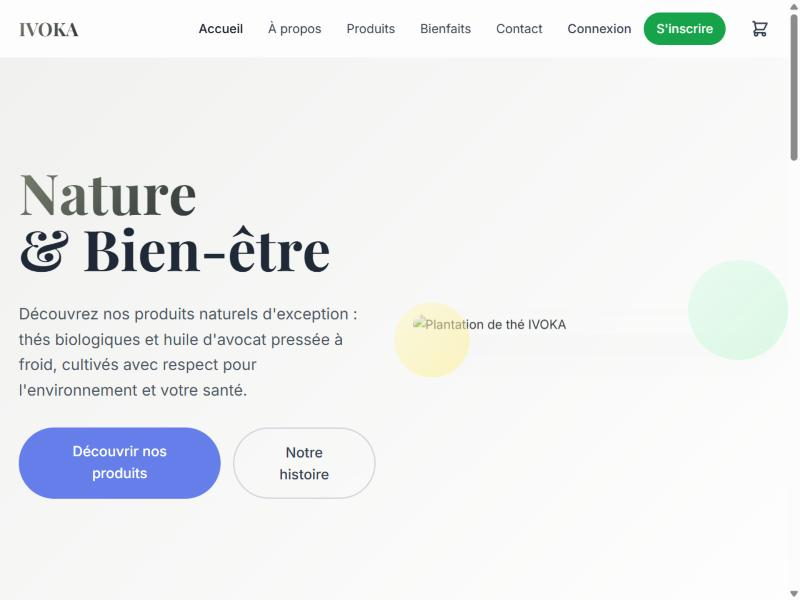
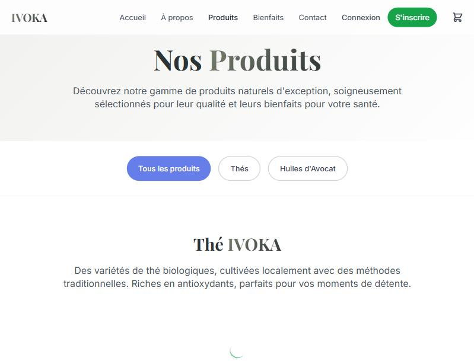
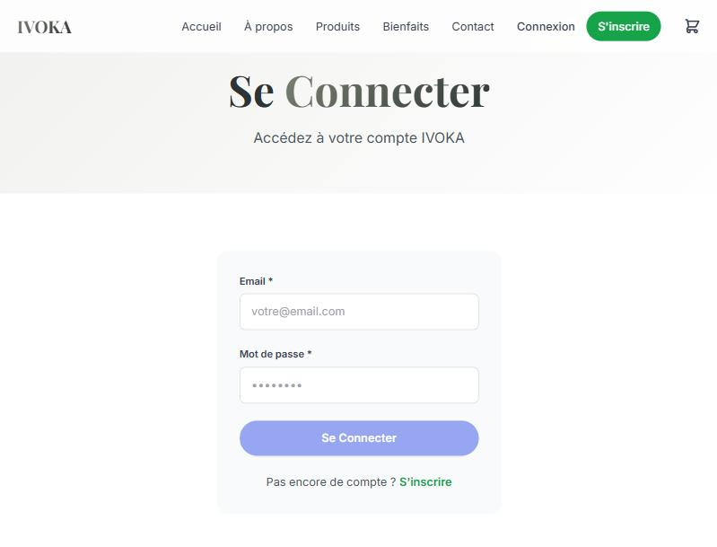
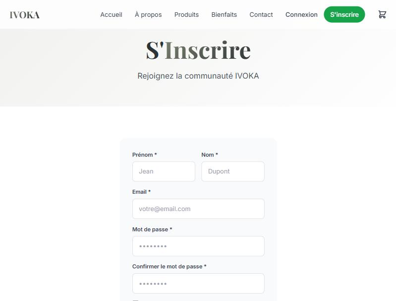
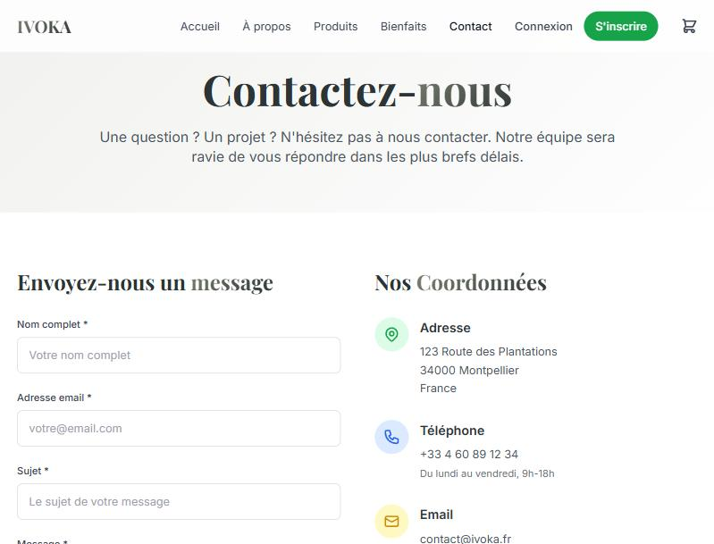

# IVOKA, Application E-commerce Full Stack

Application e-commerce pour thés biologiques et huile d'avocat naturels.  
Backend Java 21 Servlets + Frontend React 18, déployés en un seul WAR sur Tomcat.

## Captures d'écran

### Accueil


### Catalogue produits


### Connexion


### Inscription


### À propos


### Bienfaits


### Contact


---

## Stack technique

| Couche | Technologie |
|---|---|
| Backend | Java 21, Jakarta EE 6 Servlets (WAR) |
| Base de données | MySQL 8, Apache Commons DBCP2 (pool) |
| Authentification | PBKDF2WithHmacSHA256 + tokens de session en DB |
| Frontend | React 18, React Router 6, Context API |
| Style | Tailwind CSS 3, Animate.js |
| Build | Maven 3 + frontend-maven-plugin (Node embarqué) |
| Serveur | Apache Tomcat 10+ |

---

## Installation

### Prérequis

- Java 21+
- Maven 3.8+
- MySQL 8
- Node 18+ (ou laisser Maven le télécharger via le plugin)
- Apache Tomcat 10+

### 1. Créer la base de données

```sql
CREATE DATABASE ivoka_db CHARACTER SET utf8mb4 COLLATE utf8mb4_unicode_ci;
CREATE USER 'ivoka_user'@'localhost' IDENTIFIED BY 'ivoka_password';
GRANT ALL PRIVILEGES ON ivoka_db.* TO 'ivoka_user'@'localhost';
FLUSH PRIVILEGES;
```

Puis importer le schéma :

```bash
mysql -u root -p ivoka_db < backend/src/main/resources/schema.sql
```

### 2. Configurer les variables d'environnement

Copier `.env.example` en `.env` à la racine du projet et adapter les valeurs :

```bash
cp .env.example .env
```

```env
DB_HOST=localhost
DB_PORT=3306
DB_NAME=ivoka_db
DB_USER=ivoka_user
DB_PASSWORD=your_password

CORS_ALLOWED_ORIGINS=http://localhost:3000,http://localhost:8080
REACT_APP_API_URL=http://localhost:8080/ivoka-api/api
```

Copier également `frontend/.env.example` en `frontend/.env` :

```bash
cp frontend/.env.example frontend/.env
```

### 3. Builder et déployer

```bash
cd backend
mvn clean package
```

Le build Maven va automatiquement :
1. Télécharger Node 18 et npm 9 (via `frontend-maven-plugin`)
2. Faire `npm install` dans `frontend/`
3. Faire `npm run build` (React → `frontend/build/`)
4. Embarquer le build React dans le WAR

Déployer `backend/target/ivoka-api.war` dans le répertoire `webapps/` de Tomcat.

### 4. Accéder à l'application

```
http://localhost:8080/ivoka-api/
```

---

## Développement

### Frontend seul (sans backend)

```bash
cd frontend
npm install
npm start
# → http://localhost:3000/ivoka-api
```

### Backend seul (API)

Déployer sur Tomcat et tester les endpoints :

```
POST http://localhost:8080/ivoka-api/api/auth   (action: register/login/logout)
GET  http://localhost:8080/ivoka-api/api/products
GET  http://localhost:8080/ivoka-api/api/admin  (Bearer token admin requis)
```

---

## Fonctionnalités

### Boutique
- Catalogue produits filtrable par catégorie (Thés / Huiles d'Avocat)
- Panier avec gestion des quantités
- Historique de commandes

### Authentification
- Inscription avec validation : email, mot de passe fort (≥ 8 caractères, majuscule + minuscule + chiffre)
- Connexion avec token de session stocké en base
- Mots de passe hashés PBKDF2WithHmacSHA256 (sel aléatoire, 10 000 itérations)

### Back-office (admin)
- Dashboard avec statistiques produits et utilisateurs
- CRUD produits et utilisateurs
- Accès protégé par vérification du rôle admin sur chaque endpoint

### Pages
- Accueil avec section valeurs et newsletter
- À propos avec histoire de la marque
- Bienfaits des produits
- Formulaire de contact

---

## Sécurité

| Problème | Correction |
|---|---|
| CORS wildcard `*` + credentials | Whitelist d'origins avec header `Vary: Origin` |
| Token mismatch login | Frontend lit `sessionToken` (clé renvoyée par l'API) |
| Mot de passe faible accepté | `isPasswordStrong()` : 3 types de caractères requis |
| Credentials DB hardcodés | `DatabaseConnection` charge `.env` en priorité |
| Logs `printStackTrace()` | `java.util.logging.Logger` dans tous les Servlets |

---

## Structure

```
ivoka/
├── backend/
│   ├── src/main/java/com/ivoka/api/
│   │   ├── dao/            # Accès base de données (DAO pattern)
│   │   ├── filter/         # CORSFilter
│   │   ├── listener/       # DatabaseInitializer (démarrage Tomcat)
│   │   ├── models/         # Entités Java
│   │   ├── servlets/       # Endpoints REST (@WebServlet)
│   │   └── utils/          # PasswordUtils, SessionUtils
│   ├── src/main/resources/ # schema.sql
│   ├── src/main/webapp/    # WEB-INF/web.xml, index.html (React build)
│   └── pom.xml
├── frontend/
│   ├── src/
│   │   ├── components/     # Navigation, Footer
│   │   ├── context/        # AuthContext, CartContext
│   │   ├── pages/          # Home, Products, Login, Register, Admin…
│   │   └── services/       # api.js (Axios)
│   ├── .env
│   └── package.json
├── screenshots/
├── .env                    # Credentials (non versionné)
├── .env.example
└── .gitignore
```
